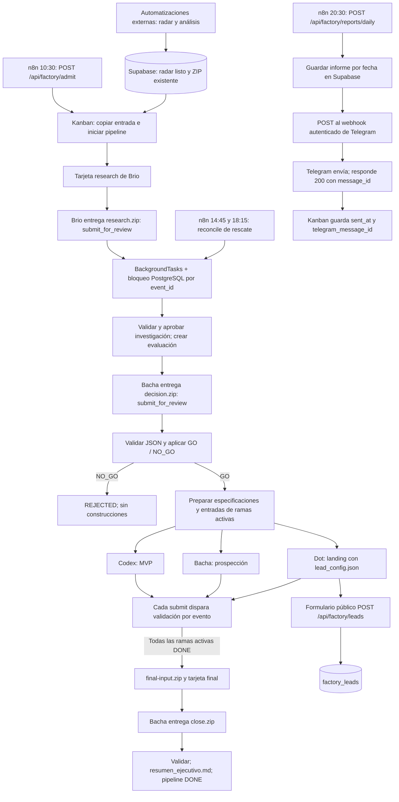

# Fábrica: operación por eventos

Fecha del cambio: 20-11-2026. Zona única: `America/Mexico_City`.
Proyecto Kanban: **1**. Base de radares autorizada: **radars-n8n**, ID
`uobeshcvmtawjxibciuy`. PostgreSQL de Kanban y Supabase son bases distintas.

## Limpieza del tablero: 21-11-2026

Por instrucción del operador se archivaron las 56 tarjetas históricas del
proyecto 1: 35 `done` y 21 `cancelled`. Todas quedaron en `cancelled`, sin
reclamo y con `metadata_payload.board_archived=true`; se conservan el estado
anterior en `board_previous_status`, fecha, comentario y evento de auditoría.
Los listados REST/MCP omiten archivadas; siguen disponibles por ID y conservan
sus archivos. Las nuevas tarjetas que terminen en `done` sí se mostrarán.

Verificación posterior en el API desplegado: solo **#38 y #40**, ambas `ready`;
los listados `done` y `cancelled` están vacíos. El tablero ahora ocupa la altura
de la pantalla y cada columna tiene scroll independiente con encabezado fijo.
28 tests de tareas/servicios aprobados, build y lint del frontend correctos
(advertencias existentes); Chromium confirmó altura limitada y scroll
independiente en dos tamaños de ventana, con datos ficticios.

Respaldo previo de PostgreSQL y registros afectados:
`/home/cheko/.config/agent-kanban/backups/board-cleanup-20261121-000535/`.
Imagen previa: `agent-kanban-app:before-board-cleanup`.

Backend Kanban, gateway Cloudflare y puente Dot desplegados el 20-11-2026.
Los workflows nuevos están publicados y los timers antiguos de polling y
Evolution están desactivados. Codex fue reanudado por instrucción explícita:
timer habilitado, próxima ejecución 21-11-2026 15:00 CDMX.

**Telegram verificado:** el operador autorizó reutilizar `openai-radar-header`.
Se configuró su valor exacto de Authorization, sin modificar la credencial de
n8n ni mostrarlo en logs. El backend envió una comprobación real y recibió
`ok=true`, `telegram_message_id=290`; ejecución n8n **409**, estado `success`.
El token almacenado en MegaMCP no coincidía con esa credencial; no se utilizó
como sustituto ni se rotaron claves para ocultar la diferencia.

El operador administra Brio, Bacha, Dot y las automatizaciones iniciales.
No se cambian sus horarios externos desde n8n ni se atribuyen como verificados.

## Flujo completo



1. Las automatizaciones externas generan el radar, su análisis y ZIP inicial.
   Sus programaciones se administran fuera de estos dos workflows; no se
   cambiaron a 08:00–09:00 mediante este refactor.
2. `/admit` consulta lotes de hasta 50 candidatos hasta agotar los disponibles:
   `analysis_status=completed`, `muse_status=ready`, `package_status=ready`, sin
   pipeline previo. Los errores de origen conservan el backoff SQL de una hora.
   Solo admite Gobierno NL, Compras Públicas y Regulación Federal.
3. Copia el ZIP existente a `01_input/paquete.zip`, sin borrar el original;
   crea las carpetas y el pipeline `RESEARCH`, y despacha la tarjeta de Brio.
   Una llamada manual a `/admit` también funciona fuera de las 10:30.
4. Cada agente reclama su propia tarjeta, descarga su entrada, trabaja, publica
   avances y entrega con `submit_for_review`. La tarjeta queda en `review`.
5. Tras el commit, REST adjunta `BackgroundTasks` a la respuesta. MCP ejecuta
   el mismo callable de `BackgroundTasks` mediante una tarea asyncio retenida.
   Se abre una sesión independiente y se serializa la oportunidad con un
   advisory lock de PostgreSQL derivado de `event_id`. No se llama a n8n para
   detectar entregas y no se consulta toda la cola cada cinco minutos.
6. Se validan tarjeta, identidad, evento, ruta, ZIP y contrato de la etapa.
   Una entrega válida se aprueba técnicamente y avanza Supabase; la clave de
   despacho estable evita duplicar la siguiente tarjeta.
7. Investigación aceptada: `EVALUATING` y tarjeta de Bacha. Evaluación NO_GO:
   `REJECTED`. GO: `BUILDING`, especificaciones y tarjetas de ramas activas,
   independientes entre sí. Las desactivadas son `SKIPPED`.
8. Las ramas aceptadas pasan a `DONE`. Cuando todas las activas terminan,
   se genera `final-input.zip`, el pipeline pasa a `FINAL_REVIEW` y se crea la
   tarjeta final. Cierre aceptado: `DONE`, resumen y fecha en Supabase.
9. `/reconcile` recupera eventos perdidos o transiciones parciales. No admite
   candidatos y no genera informes. No tiene ventana rígida; es una acción
   con efectos reales, no una prueba de conectividad.
10. `/reports/daily` genera una fila por fecha y envía el mensaje directamente
    al webhook. Si la fecha ya está enviada, devuelve `already_sent`. Si existe
    sin enviar, reutiliza su texto. Antes de `FACTORY_REPORT_HOUR` responde
    `not_due`. El informe es una instantánea, no se regenera con cierres tardíos.

## Horarios y límites

Las horas finales son exclusivas para nuevos reclamos: a las 12:30 ya no se
reclama investigación, por ejemplo. **La ventana es para tomar tickets, no
para terminarlos.** La tarjeta activa continúa con avances y heartbeat; se
sube y entrega en cuanto termine, incluso horas después o al día siguiente.
No esperar a otra ventana para registrar el resultado.

| Hora / ventana | Actor | Acción | Reintento |
|---|---|---|---|
| 10:30 | n8n → Kanban | Admisión diaria | HTTP: máximo 2 intentos, espera 5 s; manual después si es necesario |
| 10:35–12:30 | Brio | Nuevos reclamos de investigación | Termina si no hay tarjeta o el reclamo se rechaza; no polling continuo |
| 13:00–14:30 | Bacha | Nuevos reclamos GO/NO_GO | Misma regla |
| 14:45 | n8n → Kanban | Rescate puntual | HTTP: máximo 2 intentos, espera 5 s |
| 15:00–17:30 | Codex / Dot / Bacha | MVP / landing / prospección | Una tarjeta activa por agente; siguiente solo tras entregar y dentro de ventana |
| 18:15 | n8n → Kanban | Segundo rescate puntual | HTTP: máximo 2 intentos, espera 5 s |
| 18:30–19:30 | Bacha | Nuevos reclamos de cierre | Solo oportunidades completas |
| 20:30 | n8n → Kanban | Informe diario por push | HTTP: máximo 2 intentos, espera 5 s; si falla, queda pendiente para reintento explícito |
| Al entregar | Kanban | Validación y avance por evento | Rescates puntuales si se pierde la ejecución |
| Al bloquear o fallar proceso crítico | Kanban → n8n | Alerta inmediata por push | Un intento de push; fallo queda en `factory_runtime` y logs |

**WIP=1 global:** un advisory lock transaccional por identidad serializa los
reclamos y la consulta de tarjetas `in_progress` abarca todos los proyectos.
Aplica también a Codex y Dot. Brio/Bacha conservan además la exclusión de Muse:
no pueden mantener trabajos simultáneos entre ellos en el proyecto 1.

**Cuota MVP:** como máximo `FACTORY_MAX_DAILY_MVP` tarjetas nuevas de rama MVP
por fecha local, incluyendo las canceladas creadas ese día. El límite se
comprueba bajo lock transaccional, también ante despachos concurrentes.
Las otras ramas pueden despacharse aunque el MVP quede aplazado por cuota;
se registra `quota:<event_id>` en `factory_runtime`. Un rescate posterior, en
otra fecha, puede crear el MVP pendiente. No se altera el GO ni se finge DONE.

Codex conserva un timer local de consulta cada cinco minutos exclusivamente
durante 15:00–17:25. **No es polling de n8n/Supabase.** El lanzador mantiene
un lock de proceso y la unidad un límite de seis horas. Ninguno corta la
entrega a las 17:30; una interrupción por límite del servicio requiere revisión
explícita del reclamo. El timer quedó instalado y habilitado tras la autorización de despliegue.

## Contratos y ubicaciones

Raíz WSL: `/mnt/c/_mcp/muse-packages/<event_id>/`.
Raíz equivalente en contenedores: `/muse-packages/<event_id>/`.
No buscar ZIP por su nombre global; siempre usar tarjeta/evento/metadatos.

| Etapa / creador | Entrada | Entrega o archivo generado |
|---|---|---|
| Automatización externa | Señal radar | ZIP original; el servidor conserva su ubicación original |
| Kanban | ZIP original | `01_input/paquete.zip` |
| Brio | `01_input/paquete.zip` | `02_research/research.zip`: `hallazgos.md`, `fuentes.json`, `propuesta_mvp.md` en raíz |
| Bacha, evaluación | `02_research/research.zip` | `03_specs/decision.zip`: `decision.json` en raíz |
| Kanban, GO | Decisión e investigación | `03_specs/decision.json`; `.md` y ZIP de cada rama activa |
| Codex | `03_specs/mvp-input.zip`: `mvp_spec.md`, `research.zip` | `04_mvp/mvp.zip`: proyecto reproducible, README, ejemplo de configuración sin secretos y pruebas |
| Bacha, prospección | `03_specs/prospection-input.zip`: `icp_spec.md`, `research.zip` | `05_prospects/prospects.zip`: `leads.csv`, `outreach_copies.md` en raíz; sin contactar prospectos |
| Dot | `03_specs/landing-input.zip`: `landing_spec.md`, `research.zip`, **`lead_config.json`** | `06_landing/landing.zip`: proyecto y README en raíz; desarrollado y probado en su workspace |
| Kanban | Investigación, decisión y ramas activas | `07_release/final-input.zip`: `decision.json`, `research.zip` y ZIP de ramas activas |
| Bacha, cierre | `07_release/final-input.zip` | `07_release/close.zip`: `close.json` en raíz |
| Kanban | `close.json` | `07_release/resumen_ejecutivo.md` |

`decision.json` conserva `event_id`, `brio_task_id`, `decision`,
`decision_notes`, `branches` con sus tres booleanos y `specs` con los tres
prompts de texto. GO exige alguna rama y prompt por rama activa; NO_GO exige
las tres banderas falsas. No añadir claves nuevas al contrato.

`close.json` conserva únicamente `event_id` y `executive_summary`.
No se modifica su esquema para añadir una aprobación comercial.

Los ZIP deben ser íntegros y no vacíos: máximo 2.000 entradas y 100 MiB
sin comprimir. La subida REST y el puente Dot admiten hasta 10 MiB comprimidos.
El coordinador no ejecuta el código entregado ni verifica por sí mismo la
calidad visual, las afirmaciones comerciales o la validez de la investigación.

### Rechazo y corrección

- Primer fallo ZIP/JSON en `review`: `in_progress`, comentario con error e
  incremento de `metadata_payload.validation_retries`.
- Segundo fallo: `blocked` y alerta inmediata. Requiere recuperación explícita
  del operador; no resetear automáticamente el contador ni reclamar otra copia.
- Si el agente ya tiene otra tarjeta en progreso al rechazar una entrega,
  la rechazada queda `blocked` para mantener WIP=1, aunque sea su primer fallo.
- El resultado rechazado puede reemplazarse por PUT mientras su dueño conserve
  la tarjeta en `in_progress`. Una entrega inicial no se sobrescribe. Un ZIP
  aceptado y sus entradas permanecen protegidos.
- El puente Dot compara también el número de intento del recibo
  `06_landing/.dot-transfer/task-<ID>/uploaded.json`: tras rechazo acepta el
  nuevo archivo y actualiza el recibo. Debe desplegarse su módulo actualizado.
- Los errores de origen se registran con evento, clase y detalle, por ejemplo
  `evento: FileNotFoundError: ...`, no solo `ValueError`.

## Leads centrales por proyecto

Esquema real inspeccionado en `radars-n8n`: `id uuid` con default,
`event_id text NOT NULL`, `project_slug text NOT NULL`, `full_name text NOT NULL`,
`contact text NOT NULL`, `company`, `notes`, `source_url` opcionales,
`metadata jsonb` con default `{}`, `created_at timestamptz` con default.
No se crea ni migra esa tabla en este refactor.

El empaquetador añade `lead_config.json` automáticamente a entradas nuevas:

```json
{
  "event_id": "ID_DEL_EVENTO",
  "project_slug": "ID_DEL_EVENTO",
  "lead_endpoint": "https://kanban-api.okehc.com/api/factory/leads"
}
```

El slug canónico de esta fábrica es el `event_id`; no se modifica el esquema
de decisión para introducir otro identificador. Dot lee el archivo y conecta
el formulario al endpoint; no hardcodea secretos ni necesita construir backend.
El servidor comprueba que exista la oportunidad, tenga landing activa y que
el slug coincida. Los paquetes antiguos no se reescriben automáticamente.

POST público, CORS `*`, sin cookies ni credenciales del agente:

```javascript
const config = await fetch('./lead_config.json').then(r => r.json());
const response = await fetch(config.lead_endpoint, {
  method: 'POST',
  headers: {'Content-Type': 'application/json'},
  body: JSON.stringify({
    event_id: config.event_id, project_slug: config.project_slug,
    full_name: 'Nombre del interesado', contact: 'correo o teléfono',
    company: 'Empresa', notes: 'Consulta',
    source_url: window.location.href, honeypot: ''
  })
});
if (!response.ok) throw new Error('No se pudo registrar la solicitud');
```

Respuesta: `201 {"ok":true,"lead_id":"UUID"}`. Un honeypot lleno responde
201 con un ID ficticio y no inserta. Datos inválidos producen 422; proyecto
inexistente o slug incorrecto, 404. Límite de aplicación: 10 solicitudes/minuto
por IP; el gateway limita cada cuerpo público a 16 KiB. No incluir datos
sensibles en el formulario. El POST guarda solicitudes; no promete enviar
correos ni conectar agenda.

GET protegido con el **Bearer interno existente de `n8n-radares`**, con permiso
orchestrator en proyecto 1. No usar el secreto de Telegram ni exponerlo a Dot:

```bash
curl --fail --get 'https://kanban-api.okehc.com/api/factory/leads' \
  --header "Authorization: Bearer ${N8N_RADARES_KANBAN_TOKEN}" \
  --data-urlencode 'event_id=ID_DEL_EVENTO' \
  --data-urlencode 'project_slug=ID_DEL_EVENTO'
```

Ambos filtros son obligatorios; devuelve hasta 100 filas, recientes primero.
El gateway permite ese GET únicamente a la identidad interna de fábrica.

## Variables de entorno

Se mantienen `DATABASE_URL`, `MUSE_PACKAGES_ROOT`, `FACTORY_SUPABASE_URL` y
`FACTORY_SUPABASE_SECRET_KEY`; secretos solo en configuración privada.

| Variable | Valor / significado |
|---|---|
| `FACTORY_REPORT_HOUR` | `20:30`; hora mínima del endpoint de informe |
| `FACTORY_MAX_DAILY_MVP` | `2`; cuota global de nuevas tarjetas MVP por fecha CDMX |
| `PUBLIC_LEAD_ENDPOINT` | `https://kanban-api.okehc.com/api/factory/leads` |
| `N8N_TELEGRAM_WEBHOOK_URL` | `https://anyo.okehc.com/webhook/factory/telegram-notify` |
| `FACTORY_WEBHOOK_SECRET` | Valor **exacto** de la cabecera `Authorization` que valida la credencial existente `openai-radar-header`; no añadir otro prefijo |

El secreto de webhook autentica Kanban → n8n; se configuró después de la autorización explícita del operador. Es distinto del Bearer de agente
n8n → Kanban. No está embebido en los JSON. Si se cambia la hora del informe,
actualizar también el cron de `01_factory_schedule.json`: una variable de
Kanban no reprograma el timer de n8n.

## Importación y activación

1. Desplegar Kanban y el gateway actualizados, y configurar las variables
   privadas. El origen `kk.okehc.com` sigue detrás de Cloudflare Access.
   Solo el POST/preflight de leads se abre públicamente; GET y fábrica siguen
   autenticados. El gateway usa las credenciales Access de máquina existentes.
2. Importar `deploy/n8n/02_factory_telegram_webhook.json` en anyo. Reutiliza la
   credencial Header Auth `openai-radar-header` (`WXW1Qq0Mn5l5wcDr`, cabecera
   Authorization), ya existente. Elegir `Telegram Cheko` en el único placeholder
   `SELECCIONAR_TELEGRAM_CHEKO`; destino configurado `7946431920`.
3. Publicar el webhook. Comprueba cabecera antes de ejecutar nodos. Valida el
   tipo y mensaje; datos inválidos → 400, error de Telegram → 502, éxito →
   `200 {"ok":true,"telegram_message_id":...}`. No tiene un errorWorkflow que
   vuelva a notificar al mismo webhook: evitar recursión si Telegram está caído.
4. Importar `deploy/n8n/01_factory_schedule.json`. Reutiliza Bearer Auth
   `N8N_RADARES_KANBAN` (`MhO6jMfbdNT6QcOg`) y el workflow de errores publicado
   `WIL1go2TjyOL1s68`. Sus tres triggers no hacen consultas a Supabase.
5. **Desactivar** los antiguos workflows `qrBiN12e9J6bEvoc` (conciliación cada
   cinco minutos), `IDoapKWSS7Lg6eBH` (polling Telegram) y
   `m0EdU2DRzcpZqqpo` (Evolution) hasta que este último tenga un flujo real.
   Desactivar antes de publicar el nuevo calendario evita solapamientos.
6. Publicar el nuevo calendario. Reintentos HTTP de los tres endpoints: máximo
   dos intentos con cinco segundos de espera; timeout 90 s por llamada y 240 s
   para workflow. Los rescates siguen siendo dos ejecuciones al día, no polling.
7. Actualizar las programaciones externas de Brio, Bacha y Dot con la tabla de
   horarios y la regla de una tarjeta activa. Informar a Dot del archivo
   `lead_config.json` y desplegar el puente corregido para reentregas.
8. Instalar las unidades Codex actualizadas y revisar DNS/autenticación antes
   de cualquier reanudación. **No habilitar el timer sin instrucción humana.**

No se ejecutan pruebas de envío ni se importan/publican workflows como parte
de la generación de estos archivos. El generador antiguo
`deploy/factory/sequential-workflows.mjs` está retirado para no recrear polling.

## Fallos y recuperación

- Las tareas en segundo plano no son una cola durable. Un reinicio tras el
  commit puede dejar una tarjeta en `review`; los dos rescates o un POST manual
  autorizado a `/reconcile` la recuperan. No se añaden dependencias de colas.
- Ante fallo de validación, corregir la misma tarjeta y su ZIP. Tras dos fallos,
  el operador debe revisar el comentario y recuperar explícitamente el estado.
- Un fallo de transporte o SQL no se atribuye a un ZIP inválido: se registra
  como incidencia de pipeline y dispara alerta de proceso crítico.
- Si falla el push del informe, la fila queda sin `sent_at`. Repetir
  `/reports/daily` después de revisar el historial. Existe una ventana de
  duplicación si Telegram envió y se perdió la respuesta/confirmación; comprobar
  el chat antes de reintentar. No se promete entrega exactamente una vez.
- Si falla una alerta, queda `alert:<event_id>` en `factory_runtime` cuando la
  base está disponible. No existe un timer de reenvío oculto.
- Los informes mantienen conteos acumulados de pipelines y detalles de hasta
  ocho oportunidades; no son una auditoría comercial ni un reporte exhaustivo.

## Saneamiento del lote actual

Saneamiento aplicado el 20-11-2026 a las 23:10 CDMX:

- Conservada: `gobierno-nl-20261106-igualdad-laboral-certificado-art37bis`.
  MVP **#38** y landing **#40** en `ready`, sin `claimed_by`, `claimed_at` ni
  heartbeat. Es el alcance sin integraciones autenticadas más acotado del lote.
  Su fallo previo de DNS está registrado: no se declara resuelto. La entrada
  local existe y el MVP todavía no tenía código ni ZIP de resultado.
- Entrada #40: se añadió únicamente `lead_config.json` a `landing-input.zip`
  para la prueba del endpoint. Se conservaron idénticos los bytes de
  `landing_spec.md` y `research.zip`; el ZIP previo está en
  `landing-input-before.zip` dentro del respaldo privado indicado abajo.
- Canceladas: **#32, #35, #37, #43, #44, #46, #47, #49, #50 y #52**.
  Cada una conserva comentario y evento con la nota exacta
  `Purgado por refactor de fábrica y recorte de alcance MVP`.
- Respaldo previo privado de las doce tarjetas y verificación posterior:
  `/tmp/agent-kanban-factory-refactor-20261120-231035/` (directorio 0700,
  archivos 0600). Es temporal; conservarlo antes de limpiar `/tmp` si se
  necesita recuperación. Ninguna entrega terminada ni resultado fue borrado.
- El operador autorizó después el archivo del histórico. Los seis pipelines
  descartados pasaron de `BUILDING` a `REJECTED`, con motivo de purga y fecha de
  cierre. Se conservaron sus GO y especificaciones históricos; no se califican
  como decisiones NO_GO comerciales.
- Se archivaron también los 17 radares listos sin pipeline: `muse_status` pasa
  a `not_required`, revisión a `reviewed` y resolución a `discarded`. No se
  borraron registros ni archivos. Cada `metadata.factory_archive` conserva el
  motivo, fecha y estados anteriores. Respaldo privado:
  `/home/cheko/.config/agent-kanban/backups/factory-event-20261120-233138/sources-before-archive.json`.
- Comprobación posterior: **6 REJECTED, 3 DONE y 1 BUILDING**, correspondiente
  a la oportunidad conservada; la admisión no devuelve candidatos históricos.

## Verificación

Cinco pruebas nuevas en `tests/test_factory_events.py`: avance inmediato,
entrega fuera de ventana, WIP concurrente Codex/Dot, rechazo hasta bloqueo y
leads públicos/lectura protegida por filtros. PostgreSQL desechable en localhost,
base `kanban_test_*`; Supabase y Telegram simulados. Se actualizan los tests
existentes afectados de horarios, admisión e informe por push.

Los doce nodos de los dos JSON se comprobaron con `validate_node_config` de
anyo, sin importarlos ni ejecutarlos. Esa comprobación valida parámetros; no
sustituye una prueba de credenciales y entrega real tras el despliegue.

Resultados de la comprobación local final:

```bash
.venv/bin/python -m pytest tests/test_factory_events.py tests/test_factory_sequential.py tests/test_factory_files.py tests/test_task_packages.py tests/test_orchestration.py -q
# 19 passed, con PostgreSQL desechable; cinco tests nuevos.
node --test deploy/bacha-rest/worker.test.mjs
# Correcto, incluyendo POST público y GET protegido de leads.
```

Puente Dot: cinco tests existentes aprobados sobre copia temporal del módulo
y de su dependencia audit, con transporte simulado; incluye reentrega tras
rechazo. Ruff (errores F/E9 en archivos afectados) y `git diff --check` correctos.
Esa fase local no escribió leads ni envió Telegram. Durante el despliegue posterior sí se comprobó una inserción sintética de leads (eliminada al terminar) y un envío Telegram real: mensaje 290.

## Despliegue efectivo del 20-11-2026

| Componente | Identificador / comprobación |
|---|---|
| Backend | `agent-kanban-app-1`, aplicación recompilada y arrancada; Postgres 17 conservado |
| Gateway | `kanban-bacha-rest`, versión `ab034d94-3d4c-491b-b849-ef1c01421133` |
| MegaMCP | `mega-mcp-dot-bridge:20261120-event`, imagen derivada de la anterior; entorno comparado sin diferencias |
| n8n calendario | `9Lby1BWDmyWfvvTd`, activo, zona CDMX |
| n8n webhook Telegram | `Z6euQtaOdQ2UDWnE`, activo; autenticación y envío confirmados, mensaje 290 / ejecución 409 |
| n8n registro de errores | `WIL1go2TjyOL1s68`, conservado y enlazado al calendario |
| Antiguos workflows | `qrBiN12e9J6bEvoc`, `IDoapKWSS7Lg6eBH`, `m0EdU2DRzcpZqqpo`: inactivos |
| Codex | `kanban-codex.timer` enabled/active; --check muestra solo #38 |
| Dot | factory_dot_status: connected=true, project_id=1, ready=[40] |

Respaldo PostgreSQL/configuración y copia persistente del saneamiento:
`/home/cheko/.config/agent-kanban/backups/factory-event-20261120-233138/`.
Imágenes de recuperación: `agent-kanban-app:before-factory-event` y
`mega-mcp-dot-bridge:before-factory-event`. No reconstruir el checkout ajeno de
MegaMCP para restaurar: la imagen derivada preserva dashboard y túnel.

Se verificó POST público de leads (201), GET interno (200), GET sin token
(401), separación por proyecto, CORS y honeypot. El registro sintético de prueba
fue eliminado; se comprobó que no quedara en Supabase. La entrada MVP se leyó
con `codex sandbox` usando un perfil temporal heredado de `:read-only`, sin
red, sin modelo y sin modificar la política del worker. La guía de Codex usa
la copia local canónica del ZIP después de confirmar el reclamo, para que un
fallo de DNS del shell no impida leer una entrada ya existente.

### Automatizaciones iniciales que configura el operador

Distribución acordada como referencia, no aplicada por esta sesión:

| Hora CDMX | Automatización |
|---|---|
| 08:00 | Búsqueda Gobierno NL |
| 08:10 | Búsqueda Compras Públicas |
| 08:20 | Búsqueda Regulación Federal |
| 08:30 | Análisis Gobierno NL |
| 08:40 | Análisis Compras Públicas |
| 08:50 | Análisis Regulación Federal |

Competencia ServicePlace no se incorpora a esta fábrica. Una búsqueda que se
prolongue puede no estar lista para su análisis; no marcarla como completada
por horario. La admisión es a las 10:30.

### Verificación final del push

Tras la autorización explícita del operador se alineó el secreto del backend
con `openai-radar-header`. El webhook respondió 400 a un payload inválido
autenticado y 200 al envío real: mensaje Telegram **290**, ejecución **409**
correcta. La comprobación manual del trigger «Informe 20:30», ejecución
**410**, terminó `success` y devolvió `already_sent` para el 20-11-2026: no
duplicó el informe existente. No se ejecutó admisión ni se reclamaron tarjetas
durante estas comprobaciones. El valor secreto no se imprimió ni se versionó.
