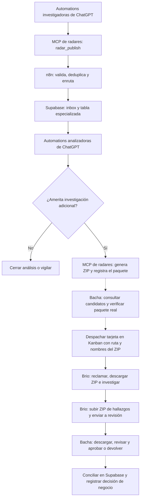

# Flujo de radares, análisis y entregas de Muse en Kanban

El contrato vigente y el estado del montaje están en [Operación de la fábrica en anyo](factory/README.md). Bacha decide GO/NO_GO y n8n despacha y cierra tarjetas. Esta auditoría conserva el contexto histórico del tramo de radares y del piloto. Sus referencias a la instancia anterior describen el sistema previo al corte hacia anyo.

**Fecha de referencia:** 18 de noviembre de 2026. **Destinatarios:** agentes que van a diseñar y completar la integración.

El flujo de radares ya detecta hallazgos, los enruta por n8n, guarda el análisis en Supabase y prepara paquetes ZIP para algunos casos. En Kanban, Bacha y Brio ya completaron un piloto de despacho, descarga, investigación, carga y aprobación de un ZIP. **El tramo a completar es que Bacha tome un paquete real listo en Supabase, compruebe que Kanban puede leerlo, cree una sola tarjeta para Brio y devuelva a Supabase la referencia de la entrega.**

El tramo de radares se describe según la auditoría del **14 de noviembre**. Sus conteos y horarios corresponden a ese corte. Los roles, el montaje y los estados de Kanban se verificaron por separado para esta guía. El piloto de Kanban usó datos sintéticos. La tarjeta de Nuevo León mencionada al final corresponde a otro trabajo.



Las flechas punteadas representan la integración que falta verificar con un evento real. Desde el despacho hasta la revisión del ZIP, el flujo ya pasó en el piloto.

## 1. Detección y publicación

Las investigadoras son **cuatro tareas de ChatGPT Automations**. En el inventario del 14 de noviembre estaban activas en modo `condition_watch`. Comparan fuentes públicas con lo ya conocido y publican únicamente cambios materiales. Las horas de próximas revisiones que aparecían en la auditoría eran observaciones de ese día.

| Radar | Clave de enrutamiento | Fuentes o señales principales |
| --- | --- | --- |
| Gobierno de Nuevo León | `gobierno-nl` | Portal estatal, Periódico Oficial, Congreso y dependencias. Trámites, obligaciones, digitalización e inspecciones. |
| Compras Públicas | `compras-publicas` | Compras MX, compras federales y de NL. Licitaciones, anexos, juntas, modificaciones y cierres. |
| Regulación Federal | `regulacion-federal` | DOF y autoridades federales. Vigencia, obligaciones, transitorios y requisitos. |
| Competencia ServicePlace | `competencia-serviceplace` | Competidores y marketplaces. Precios, funcionalidad, expansión y políticas. |

Por cada hallazgo nuevo, la investigadora invoca `radar_publish` en el MCP de radares. El contrato `RadarEvent v1` lleva `schema_version`, `event_id`, `radar`, `category`, `detected_at`, `title`, `summary`, `source_url`, `source_name`, `published_at` si se conoce, `documents[]` y `metadata.keywords`.

**`event_id` identifica el hallazgo desde su detección.** Si se reintenta una publicación, debe conservar ese ID. Si la automatización reporta el hallazgo al usuario pero falla al publicar, el aviso y la persistencia pueden quedar desalineados. Se reconcilian por `event_id`.

## 2. n8n y persistencia en Supabase

El workflow de ingesta auditado es **Radar Event Ingestion → Supabase (Inbox & Routing)**, ID `2cXrqzEr7oLWZVG2`. Recibe `POST /webhook/radar-events` en `https://nn.domify.mx`. La secuencia observada es validar el payload, buscar duplicados, guardar en el inbox, elegir la rama por `radar`, insertar en su tabla y marcar el registro como `routed`. El workflow envía el aviso de ingreso por Telegram. En el mapa, el camino de duplicado devuelve `200` y el ingreso nuevo devuelve `201`. [Workflow de ingesta](https://nn.domify.mx/workflow/2cXrqzEr7oLWZVG2)

La base de los radares es **Supabase `radars-n8n`**, proyecto `uobeshcvmtawjxibciuy`. Es distinta de la base local de Agent Kanban. [Proyecto de Supabase](https://supabase.com/dashboard/project/uobeshcvmtawjxibciuy/editor)

| Tabla | Qué guarda |
| --- | --- |
| `radar_events_inbox` | Evento canónico, payload original, fuente, metadatos y estado de enrutamiento. |
| `radar_gobierno_nl` | Enriquecimiento de trámites, obligaciones y oportunidades del estado. |
| `radar_compras_publicas` | Expediente, comprador, fechas, montos, análisis de viabilidad y posibles paquetes. |
| `radar_regulacion_federal` | Autoridad, vigencia, obligaciones, evidencia y estado de investigación. |
| `radar_competencia_serviceplace` | Cambios en competidores, impacto y seguimiento. |
| `radar_events` | Tabla general histórica. La ruta auditada utiliza el inbox y las tablas especializadas. |

Las tablas de rama conservan `event_id` y enlazan al inbox mediante `inbox_id`. El campo `documents` contiene referencias a los documentos. Para saber qué anexos físicos están disponibles hay que comprobar el paquete.

La auditoría observó **75 eventos enrutados, 72 análisis completos, 3 en procesamiento, 26 candidatos a Muse y 24 paquetes marcados como listos**. Al corte no había envíos a Muse, resultados retornados ni resoluciones finales registrados en esas filas. Estos números son una referencia histórica para la conciliación inicial.

## 3. Análisis y decisión de preparar un ZIP

Otro conjunto de **cuatro tareas de ChatGPT Automations** toma los pendientes guardados en Supabase a través del MCP de radares. Estos son los horarios documentados en `America/Mexico_City`.

| Rama | Hora | Herramientas MCP | Prepara ZIP |
| --- | --- | --- | --- |
| Gobierno NL | 09:00 | `radar_gobierno_get_pending`, `radar_gobierno_update_analysis`, `radar_gobierno_build_muse_package` | Sí, para casos elegibles |
| Compras Públicas | 10:00 | `radar_compras_get_pending`, `radar_compras_update_analysis`, `radar_compras_build_muse_package` | Sí, para casos elegibles |
| Regulación Federal | 11:00 | `radar_regulacion_get_pending`, `radar_regulacion_update_analysis`, `radar_regulacion_build_muse_package` | Sí, para casos elegibles |
| Competencia ServicePlace | 12:00 | `radar_competencia_get_pending`, `radar_competencia_update_analysis` | Su recorrido termina en análisis y seguimiento |

1. El analizador usa `get_pending({claim:true,limit:10})`. El reclamo cambia los registros pendientes a `processing`. Para inspeccionar sin reclamar usa `claim:false`.
2. Contrasta la fuente primaria, separa hechos de hipótesis y guarda el análisis con `update_analysis`, incluyendo el resumen, la razón, la oportunidad o el siguiente paso y `analysis_status=completed`. Obsidian puede aportar contexto histórico.
3. Decide si una investigación adicional cambiaría una decisión. Gobierno revisa estatus legal, obligatoriedad y usuarios afectados. Compras distingue una contratación concreta de una oportunidad reutilizable. Regulación revisa vigencia, obligaciones y evidencia. Competencia queda fuera de la cola ZIP documentada.
4. Para un caso elegible con `muse_candidate=true`, llama a `*_build_muse_package` con el `event_id`, `muse_prompt`, `research_questions[]`, contexto y fuentes necesarias. La opción `download_documents` controla si se intenta incluir documentos externos.
5. La preparación registra `package_path`, `package_filename`, `packaged_at`, `package_status` y `muse_status` en Supabase. `package_status=ready` indica que puede pasar a verificación y despacho.
6. Si procesó registros o hubo errores, la automatización envía el resumen de la corrida. Gobierno tiene su propio webhook. El resto usa el notificador general. [Notificador de Gobierno](https://nn.domify.mx/workflow/Otx2R5fYETuuVLG9) · [Notificador general](https://nn.domify.mx/workflow/TKnfDV4CLzyKj1yn)

En el diseño auditado, n8n espera a Telegram en algunos caminos antes de responder. Un fallo de notificación puede ocurrir después de la persistencia. También se observaron ramas de error que requieren verificación y registros atascados en `processing`. Conviene consultar los estados antes de reintentar una corrida o reclamar esas filas.

## 4. De un paquete listo a una tarjeta de investigación

**Responsable actual de orquestación: Bacha. Worker validado: Brio, que corre en Muse. Proyecto Kanban del piloto: `1`.** Kanban ya acepta el despacho y el intercambio de archivos. Falta comprobar cómo obtendrá Bacha los candidatos de Supabase y automatizar el paso de selección, despacho y conciliación. El mapa histórico mencionaba a Hermes en esta función. Los permisos de Kanban del proyecto 1 corresponden hoy a Bacha.

### Seleccionar y verificar el paquete

1. Bacha necesita una fuente de candidatos que permita leer las tres tablas elegibles sin tomar los pendientes de los analizadores. El filtro propuesto combina `analysis_status=completed`, `muse_candidate=true`, `package_status=ready` y `muse_status=ready`.
2. Lee el `event_id`, la rama, `package_path`, `package_filename` y la fecha o versión. Comprueba el ZIP real, su integridad y que incluya el prompt, las preguntas, las fuentes y los anexos previstos. Confirma vigencia o plazos cuando afecten la prioridad.
3. Usa una clave de despacho por **`event_id` + versión o hash del paquete**. Busca primero una tarjeta con esa referencia. Si un POST vence o devuelve un resultado ambiguo, busca la tarjeta antes de repetirlo. La búsqueda manual ya forma parte de las instrucciones de Bacha. La prevención automática de duplicados para paquetes de radar todavía requiere integración.
4. Comprueba que el archivo exista **dentro del contenedor** en la ruta relativa que usará la tarjeta. Los paquetes auditados se registran bajo `/mnt/c/_mcp/muse-packages/<event_id>/<fechaUTC>/` en WSL. Kanban configura `MUSE_PACKAGES_ROOT=/muse-packages`, pero actualmente sólo monta `pilot/brio-zip`. Un paquete real fuera de ese montaje requiere primero una carpeta visible para Kanban. El despacho puede devolver `201` aunque la carpeta todavía sea inaccesible.

### Despachar y verificar la tarjeta

Bacha usa la herramienta MCP `dispatch_task` o `POST /api/tasks/dispatch`. Su identidad tiene rol `orchestrator`. Reserva el ticket con `assigned_to: "brio"` e incluye el objetivo, las preguntas, la evidencia esperada y los metadatos de interconexión. Este ejemplo usa valores ficticios. Para un caso real, sustituye la carpeta y comprueba el montaje antes de usarlo.

```json
{
  "project_id": 1,
  "title": "Investigar el hallazgo del radar",
  "description": "Abre el ZIP, responde las preguntas del paquete y entrega fuentes y hallazgos.",
  "assigned_to": "brio",
  "priority": "MEDIUM",
  "metadata": {
    "radar": "gobierno-nl",
    "event_id": "gobierno-nl-ejemplo",
    "package_version": "20261118T120000Z",
    "muse_zip": {
      "path": "gobierno-nl-ejemplo/20261118T120000Z",
      "input_file": "paquete.zip",
      "output_file": "hallazgos.zip"
    }
  }
}
```

En REST el campo de entrada se llama **`metadata`**. En la respuesta y en la lectura del ticket aparece como **`metadata_payload`**. Confirma el `201`, el ID, el proyecto, la reserva y los tres campos de `metadata_payload.muse_zip` con un `GET /api/tasks/{id}`. El `path` debe ser relativo y el resultado debe tener un nombre distinto al ZIP de entrada. Avisa a Brio cuando esa comprobación pase. Para Bacha, el despacho por MCP con esos campos ya quedó probado desde su canal. La primera tarjeta de prueba que envió por REST llegó vacía de metadata, así que conviene conservar esta comprobación en cualquier transporte.

## 5. Ejecución de Brio y revisión de Bacha

Bacha y Brio pueden usar el mismo intermediario público con su **propio** Bearer. Si se configura MCP para un agente, usa Streamable HTTP. La transferencia de ZIP usa REST por HTTPS. El intermediario valida cada Bearer y agrega las cabeceras de Access del lado del servidor.

- **REST** · `https://kanban-api.okehc.com`
- **MCP** · `https://kanban-api.okehc.com/mcp/`
- **Autenticación del cliente** · `Authorization: Bearer <token de Kanban del agente>`. Los valores se entregan por un canal privado.

| Paso | Quién | Operación y evidencia |
| --- | --- | --- |
| Encontrar el trabajo | Brio | `list_my_tasks({"project_id":1})` por MCP o `GET /api/tasks/available?project_id=1`. Confirma el ID y `metadata_payload.muse_zip`. |
| Reclamar | Brio | `claim_task` o `POST /api/tasks/{id}/claim`. Comprueba `in_progress` y `claimed_by=brio`. |
| Descargar la entrada | Brio | `GET /api/tasks/{id}/package/input`. Espera `200` con `application/zip`, guarda y abre el archivo. |
| Investigar y reportar avance | Brio | Lee el prompt y los anexos, contrasta fuentes y registra avances con `heartbeat_and_progress` o `POST /api/tasks/{id}/heartbeat`. |
| Subir el resultado | Brio | `PUT /api/tasks/{id}/package/result` con `Content-Type: application/zip` y el ZIP binario como cuerpo. Espera `201` con nombre, tamaño y referencia. |
| Entregar | Brio | `submit_for_review` o `POST /api/tasks/{id}/submit`. Envía `summary_of_work` y la URL HTTPS del ZIP en `artifacts`. Comprueba `review`. |
| Verificar resultado | Bacha | `GET /api/tasks/{id}/package/result` con su Bearer. Abre el ZIP y revisa respuestas, citas y evidencia contra el pedido. |
| Decidir sobre la entrega | Bacha | `review_task` o `POST /api/tasks/{id}/review` con `APPROVE` o `REJECT` y feedback. Aprobar deja la tarjeta en `done`. Rechazar devuelve el trabajo a `in_progress` si conserva titular. |

Las rutas de ZIP toman los nombres desde el ticket. La descarga de entrada y la carga de salida requieren que el worker sea el titular y que la tarjeta siga en `in_progress`. El resultado se guarda en la carpeta del paquete. La carga acepta hasta 10 MiB, comprueba el formato ZIP y devuelve `409` si el resultado ya existe. Si el revisor necesita una versión corregida tras una carga exitosa, hay que definir el versionado del resultado antes de repetir la carga. El endpoint actual protege la copia ya guardada.

La operación de transferencia es **PUT binario**. Brio comprobó que usar POST y multipart en esta ruta devolvía `404`. La herramienta MCP `post_artifact` registra referencias a archivos del servidor. Para transportar el archivo usa el PUT. El envío a revisión registra el resumen y las referencias, por lo que el agente debe comprobar primero el `201` de la carga.

Bacha puede reasignar un ticket en `in_progress` cuando lleve al menos 15 minutos sin actividad. Si el ticket ya tiene un ZIP de salida, incluye esa información al decidir si se reasigna, se recupera la entrega o se genera otra versión.

| Respuesta durante la operación | Qué revisar |
| --- | --- |
| `401` | Identidad del Bearer y URL del intermediario. |
| `403` en la descarga de entrada o carga | Permisos del proyecto, `claimed_by` y estado `in_progress`. |
| `404` en la ruta de ZIP | Método HTTP, ID, presencia de `metadata_payload.muse_zip`, montaje y existencia del archivo. |
| `409` al subir | Si ya existe la salida, Bacha puede comprobar el ZIP antes de pedir otra entrega. |
| `413`, `415` o `422` en la carga | Tamaño máximo, tipo `application/zip`, cuerpo binario y formato del archivo. |

## 6. Qué demostró la prueba

| Tarjeta | Hecho comprobado |
| --- | --- |
| **#8**, proyecto 1 | Piloto sintético. Bacha creó la tarjeta por REST. La primera respuesta tenía metadata vacío y se completó desde operación. Brio reclamó, descargó y cargó el ZIP desde su canal. Bacha descargó el resultado, verificó 3 filas y suma 10, y lo aprobó. La tarjeta está en `done`. |
| **#9**, proyecto 1 | Bacha confirmó que la creó por MCP con `metadata.muse_zip`. Apuntaba al mismo paquete de la #8 y quedó cancelada. Esta tarjeta confirma el despacho MCP con metadata. |
| **#7**, proyecto 1 | Investigación de Nuevo León, distinta del piloto. Está en `done` y carece de `metadata.muse_zip`. Brio reportó que conservó su ZIP en Muse. Para incorporar ese archivo a Kanban se necesita una tarjeta de entrega con una salida configurada y comprobar el PUT y la descarga desde esa tarjeta. |

El ZIP verificado de la #8 tiene **440 bytes**. Su ubicación en WSL es `/mnt/c/_mcp/muse-packages/pilot/brio-zip/canal/hallazgos.zip`. Este resultado prueba el transporte entre los agentes y el servidor. El ZIP de una investigación real se debe rastrear con el ID de su propia tarjeta y su propia carpeta.

## 7. Enlace por completar y criterios de aceptación

El cierre debe poder seguirse **desde un registro de Supabase hasta una tarjeta y un ZIP verificable**. Estos son los puntos que los agentes deben aterrizar y las pruebas que demuestran que funcionan.

| Tramo | Qué completar | Cómo se acepta |
| --- | --- | --- |
| Lectura de candidatos | Dar a Bacha una consulta o herramienta para las tres ramas, con filtro de casos listos y acceso acotado. Decidir si la inicia una agenda o una notificación. | Bacha encuentra un evento real elegible con archivo y versión identificables. |
| Visibilidad y persistencia | Acordar cómo llega el paquete real a una carpeta visible por el contenedor y cómo se respaldan las entradas y salidas. | Un ZIP real se abre desde Kanban con permiso del worker correspondiente. |
| Despacho y deduplicación | Guardar la relación `radar + event_id + versión/hash → kanban_task_id` en un lugar durable e impedir dos despachos concurrentes del mismo paquete. Las tablas especializadas auditadas carecían de `muse_job_id`. Una tabla de trabajos o una migración localizada son opciones a decidir. | Dos intentos para la misma versión devuelven la misma tarjeta. Un timeout después del despacho se reconcilia por la clave estable. |
| Inicio de investigación | Definir qué señal cuenta como acuse. Una opción es registrar la tarjeta creada como despacho y el reclamo de Brio como inicio efectivo. | Los timestamps se actualizan tras una señal verificable y quedan asociados al ID de tarjeta. |
| Retorno del resultado | Elegir cómo informar a Bacha cuando la tarjeta pasa a revisión. Tras verificar el ZIP, reflejar en Supabase los campos que existan, como `muse_completed_at`, `muse_result_path`, `muse_result_filename` y `muse_result_summary`. | El registro de radar apunta al resultado correcto y el archivo puede abrirse desde la tarjeta. |
| Revisión de negocio | Acordar quién toma la decisión y cuándo se escriben `review_status`, `resolution`, `resolution_notes` y `resolved_at`. | La aprobación técnica de la entrega se puede rastrear por separado de la resolución de negocio. Un proyecto de ejecución se crea sólo cuando la decisión lo pide. |
| Recuperación de fallos | Alinear reintentos de n8n, paquetes incompletos, reclamos atascados y resultados ya cargados. Registrar error, último intento y próximo paso. | Un fallo de notificación, un ZIP inválido o una caída durante el despacho deja un estado recuperable con una sola tarjeta por paquete. |

Para trazar el primer caso real, conserva el `event_id`, la rama, la versión/hash, el ID de tarjeta, el titular, el nombre/tamaño del ZIP de salida y el veredicto. Los estados de Supabase y las columnas de Kanban representan etapas distintas. Verifica el registro y la tarjeta antes de volver a publicar un hallazgo, crear una tarjeta o escribir un resultado.

Los agentes que revisen este documento deben entregar una propuesta verificable para esos puntos con responsables, herramienta o ruta, estado persistido y prueba de aceptación. Usen un caso real seleccionado para probar todo el recorrido cuando se habiliten su carpeta y los permisos. El piloto sintético queda como referencia de cómo se intercambian archivos.

## Referencias operativas

- [Guía de Bacha](orquestador.md), [guía de workers](workers.md), [inventario de agentes](agentes.md) y [ficha técnica](ficha-tecnica.md).
- **Mapa operativo de radares para Hermes, 14 de noviembre de 2026**. Auditoría aportada por el usuario para el tramo ChatGPT Automations → n8n → Supabase → preparación de ZIP.
- **Implementación de Kanban.** `src/agent_kanban/routes/orchestration.py`, `src/agent_kanban/routes/task_packages.py` y `deploy/bacha-rest/worker.mjs` en el repositorio Agent Kanban.
