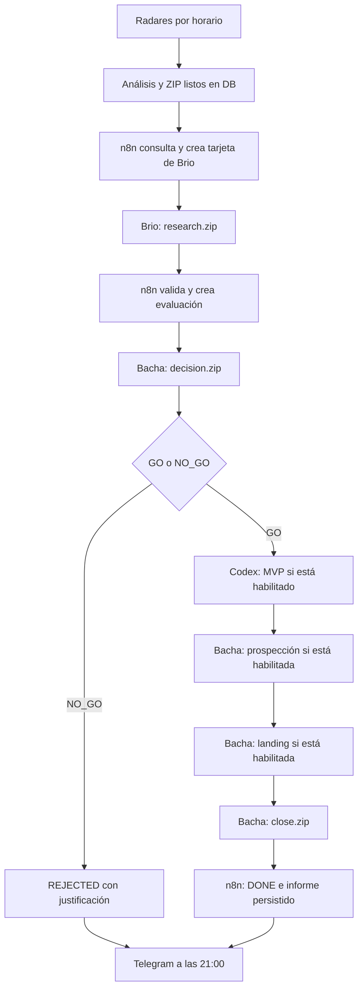

# Operación del pipeline secuencial

Montaje del **18 de noviembre de 2026**. Este es el contrato vigente; sustituye
la coordinación de fábrica por eventos. Instancia n8n: **anyo.okehc.com**.
Proyecto Kanban: **1**. Base: **radars-n8n**, `uobeshcvmtawjxibciuy`.
Zona horaria de todos los horarios: **America/Mexico_City**.

## Estado del montaje

- Coordinador y control de reclamos desplegados en el contenedor Kanban.
- Migración `factory_sequential_schedule` aplicada exclusivamente en la base de radares.
- Tres workflows nuevos publicados en anyo: conciliación, informe Telegram y registro de errores. Los WF1–WF5 anteriores están archivados.
- Consulta de n8n cada cinco minutos sin LLM, sin despertar agentes y sin callbacks de entrega.
- Telegram validado mediante un mensaje real al chat `7946431920` con la credencial `Telegram Cheko`.
- Temporizador de usuario de Codex instalado y habilitado en WSL. El CLI tiene sesión ChatGPT. Su comprobación real de cola vacía no inició el modelo.
- **Pendiente manual:** cargar las instrucciones y programaciones de Brio y Bacha en sus plataformas Muse. Esta sesión no dispone de herramientas para crear esas automatizaciones externas.
- Hay 17 ZIP históricos ausentes entre 26 registros marcados `ready`; consulta [incidencias.md](incidencias.md). No se crean tarjetas de entradas ausentes.

## Flujo y estados



Las ramas desactivadas se omiten. Todas las actividades de los workers,
incluidas evaluación y revisión final, tienen tarjeta. Solo se crea la
siguiente etapa habilitada de cada oportunidad. Varios eventos pueden estar
en cola; no se habilita todo el trabajo de un evento en paralelo.

`opportunity_pipelines.stage` conserva los estados existentes: `RESEARCH`,
`EVALUATING`, `BUILDING`, `FINAL_REVIEW`, `DONE`, `REJECTED`. El modo nuevo se
identifica con `factory_mode=sequential`. Durante BUILDING, el siguiente paso
es la primera rama activa no terminada en el orden MVP → prospección → landing.
Se añadieron `evaluation_task_id`, `final_task_id` y `last_error`.

La hora autoriza un nuevo reclamo; no acredita una entrega. Si una etapa no
terminó, las siguientes esperan. Un trabajo puede continuar otro día. El
servidor impide reclamar tarjetas de fábrica fuera de su ventana y evita
reclamos simultáneos de Brio/Bacha mientras alguno tenga una tarjeta en
progreso en el proyecto 1. Una entrega y sus heartbeat siguen permitidos si
el trabajo reclamado se prolongó después de la ventana.

## Calendario

| Hora | Actividad | Responsable |
| --- | --- | --- |
| 08:28 | Búsqueda Gobierno NL | Automatización existente |
| 09:00 | Análisis Gobierno NL | Automatización existente |
| 09:40 | Búsqueda Compras Públicas | Automatización existente |
| 10:00 | Análisis Compras Públicas | Automatización existente |
| 10:40 | Búsqueda Regulación Federal | Automatización existente |
| 11:00 | Análisis Regulación Federal | Automatización existente |
| 11:40 | Búsqueda Competencia ServicePlace | Automatización existente |
| 12:00 | Análisis Competencia ServicePlace | Automatización existente |
| 12:20 | Preparar investigación y conciliar estados | n8n |
| 12:30 | Investigación | Brio |
| 15:00 | Evaluación GO/NO_GO | Bacha |
| 16:00 | MVP | Codex |
| 18:00 | Prospección | Bacha |
| 19:00 | Landing | Bacha |
| 20:30 | Revisión final | Bacha |
| 21:00 | Informe de cierres y pendientes | n8n / Telegram |

n8n concilia cada cinco minutos de 12:20 a 22:00. Admite nuevas oportunidades
con ZIP entre 12:20 y 14:59; los resultados nuevos posteriores quedan para
el día siguiente. Puede preparar una tarjeta antes del turno del agente,
pero el servidor no permite reclamarla fuera de su horario. Codex consulta
su cola cada cinco minutos de 16:00 a 17:55, sin modelo si está vacía.

## Archivos para entregar a los agentes

- [Brio](brio.md): instrucciones y programación diaria.
- [Bacha](bacha.md): cuatro horarios y contratos de evaluación, prospección, landing y cierre.
- [Codex](codex.md): construcción local, temporizador y recuperación.
- [n8n](n8n.md): reglas mecánicas, conexiones y workflows.
- [Radar Gobierno NL](radar-gobierno-nl.md).
- [Radar Compras Públicas](radar-compras-publicas.md).
- [Radar Regulación Federal](radar-regulacion-federal.md).
- [Radar Competencia ServicePlace](radar-competencia-serviceplace.md).

Cada agente recibe exclusivamente su Bearer de Kanban. Las claves de servidor
no están en esta carpeta. Variables de Bacha/Brio: archivo privado
`~/.config/agent-kanban/kk-agents.env`, campos `BACHA_KANBAN_TOKEN` y
`BRIO_KANBAN_TOKEN`. Codex usa `codex-factory.env`; n8n mantiene su propia
credencial. No mezcles la clave de un agente con la de otro.

## Conexiones y entregas

- Admin: https://kk.okehc.com, protegido por Cloudflare Access y sesión de usuario.
- MCP: https://kanban-api.okehc.com/mcp/, Streamable HTTP con un Bearer.
- REST: https://kanban-api.okehc.com, mismo Bearer de la identidad.
- Descarga: `GET /api/tasks/{id}/package/input`, después de reclamar.
- Subida: `PUT /api/tasks/{id}/package/result`, ZIP binario, `Content-Type: application/zip`, máximo 10 MiB.
- Envío a revisión: herramienta `submit_for_review` o `POST /api/tasks/{id}/submit`.
- Los workers no llaman webhooks de fábrica. n8n detecta el estado y valida el archivo.

Raíz WSL: `/mnt/c/_mcp/muse-packages/<event_id>/`. Se conservan las siete
subcarpetas del contrato: `01_input` a `07_release`. Las nuevas entregas de
Bacha son `03_specs/decision.zip` y `07_release/close.zip`. La revisión final
recibe `07_release/final-input.zip` con las entregas activas. El resumen
aceptado queda en `07_release/resumen_ejecutivo.md`.

## Operación, recuperación y restauración

Consulta [n8n.md](n8n.md) para los enlaces e IDs. En Supabase:

- `opportunity_pipelines`: avance y último error por evento.
- `factory_runtime`: última conciliación, errores de origen y referencias a ejecuciones fallidas de n8n.
- `factory_daily_reports`: informe por fecha, estado de entrega y message ID de Telegram.

Si un agente pierde su sesión con una tarjeta en progreso, inspecciona su
última actividad y confirma que dejó de trabajar antes de recuperar el
reclamo. No se libera automáticamente solo porque dejó de enviar heartbeat;
esa liberación podría permitir dos trabajos simultáneos. El admin puede
recuperar la tarjeta, conservando comentarios y archivos. La reasignación por
API de un reclamo estancado requiere orquestador y al menos 15 minutos sin
actividad; no cambies la identidad asignada para saltar las reglas.

Un ZIP incorrecto conserva la tarjeta en revisión y registra el error. Como
la subida no sobrescribe resultados, su corrección requiere intervención del
operador sobre esa tarjeta/archivo; no recrees silenciosamente la oportunidad.

Restauración del montaje:

1. Restaura el repositorio, los volúmenes de Kanban/PostgreSQL y la raíz WSL de paquetes. Los ZIP no viven dentro de la base; respáldalos también.
2. En la base **radars-n8n**, aplica en orden `deploy/factory/supabase.sql`, `transitions.sql` y `sequential.sql` si no restauraste el esquema completo. No lo apliques a otro proyecto.
3. Recupera fuera de Git los archivos privados `kk-compose.env`, `kk-agents.env`, `n8n-radares.env`, `factory.env` y `codex-factory.env` de `~/.config/agent-kanban/`.
4. El override local `docker-compose.cloudflare.yml` conserva PostgreSQL 17, los puertos de localhost/LAN y la red del túnel. Agrega al app `env_file: [/home/cheko/.config/agent-kanban/factory.env]` y el montaje `/mnt/c/_mcp/muse-packages:/muse-packages`. `factory.env` define `FACTORY_SUPABASE_URL` y `FACTORY_SUPABASE_SECRET_KEY`; la URL debe ser la base de radares indicada arriba. No publiques sus valores.
5. Levanta el app con la composición y env-file existentes. Los montajes antiguos `workspace_tasks` pueden conservarse, pero el temporizador secuencial de Codex consulta Kanban y no depende de esos avisos Markdown.
6. Restaura el intermediario con `deploy/bacha-rest/wrangler.jsonc` y sus secretos privados. `wrangler deploy --keep-vars` conserva valores ya configurados; no recrea secretos perdidos.
7. Importa los tres JSON de `workflows/`, selecciona las credenciales correspondientes y fija `America/Mexico_City`. Publica primero el registrador de errores; vincúlalo por su nuevo ID en los otros dos antes de publicarlos.
8. Copia `deploy/factory/kanban-codex.service` y `.timer` a `~/.config/systemd/user/`, conserva el archivo privado de Codex, ejecuta `systemctl --user daemon-reload` y `systemctl --user enable --now kanban-codex.timer`. Ajusta rutas de usuario si restauras en otro host y confirma `codex login status`.
9. Carga los prompts y horarios de Brio/Bacha en sus Muse. No importes simultáneamente los workflows históricos por eventos.

Si Telegram acepta un mensaje y falla la confirmación en DB, puede repetirse
el informe en un reintento. Verifica el chat y la ejecución antes de reenviarlo.
El cierre del trabajo y la entrega del informe se registran por separado.

## Verificación realizada

Las pruebas locales cubren el ciclo de seis tarjetas, archivos, transición
secuencial, NO_GO, reintentos de despacho, horarios, exclusión concurrente de
Muse, informe diario único y el lanzador sin modelo ante cola vacía. Se usó
PostgreSQL temporal; no se pusieron tareas ficticias en la base productiva.

En n8n, la ejecución 43 probó el coordinador real y la 44 envió el mensaje de
comprobación de Telegram. En esta última se simularon la lectura del informe
y su confirmación para no registrar un cierre ficticio. El registrador de
errores se comprobó con respuestas simuladas en la ejecución 42. El cron real
terminó correctamente en la ejecución 45, a las 16:50 de Ciudad de México.
El temporizador local se ejecutó a las 16:55, encontró la cola vacía y terminó
sin iniciar Codex.

Comandos de verificación ejecutados:

```bash
.venv/bin/pytest -q tests/test_factory_sequential.py tests/test_factory_files.py tests/test_task_packages.py tests/test_orchestration.py
.venv/bin/pytest -q tests/test_factory_sequential.py
node --test deploy/bacha-rest/worker.test.mjs
```

El conjunto integrado pasó 13 casos; después se añadió la comprobación de
orígenes inválidos y se repitieron únicamente las seis pruebas del coordinador,
todas correctas. Las otras ocho verificaciones ya habían pasado. Ruff y
`git diff --check` no reportaron incidencias en los archivos nuevos. El escaneo
de cambios y exportaciones no encontró valores de secretos privados.

Los cron de n8n y el temporizador local están activos. Falta comprobar una
jornada real con Brio y Bacha después de cargar sus instrucciones y horarios;
no se ejecutó investigación ni construcción en lugar de esos agentes.
